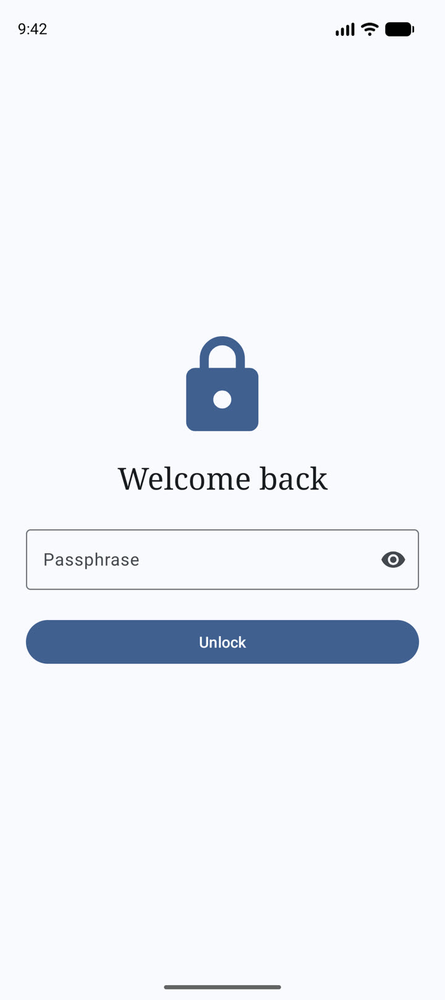
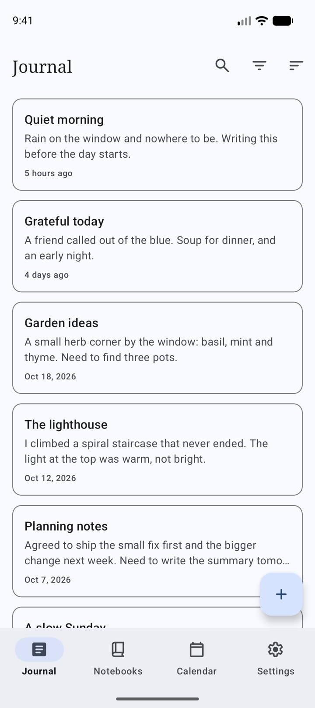
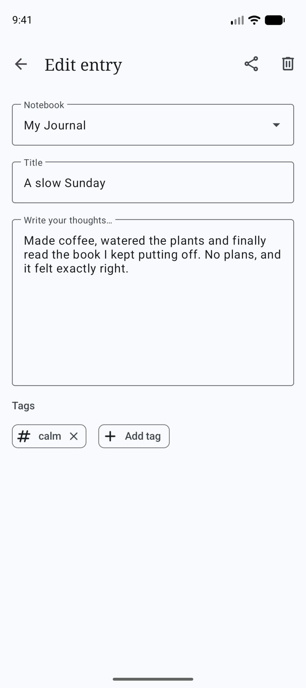
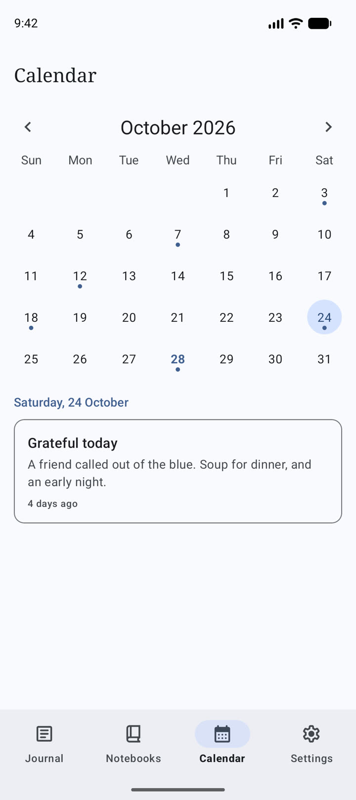
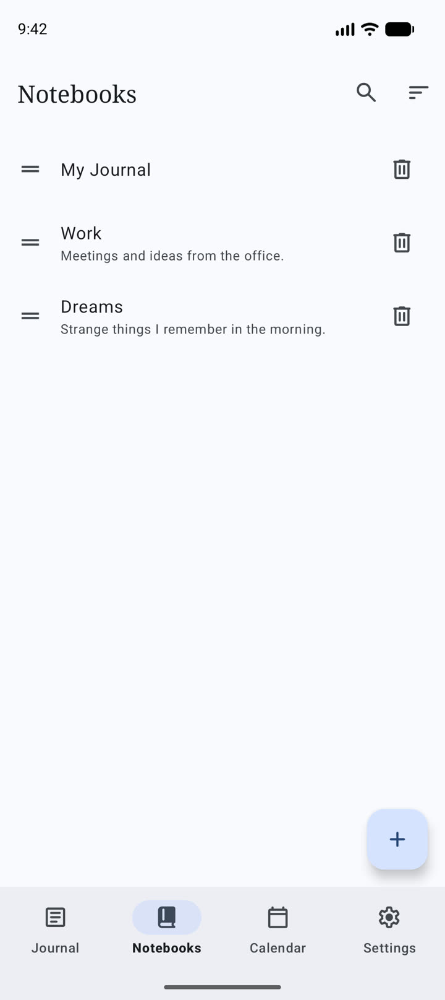
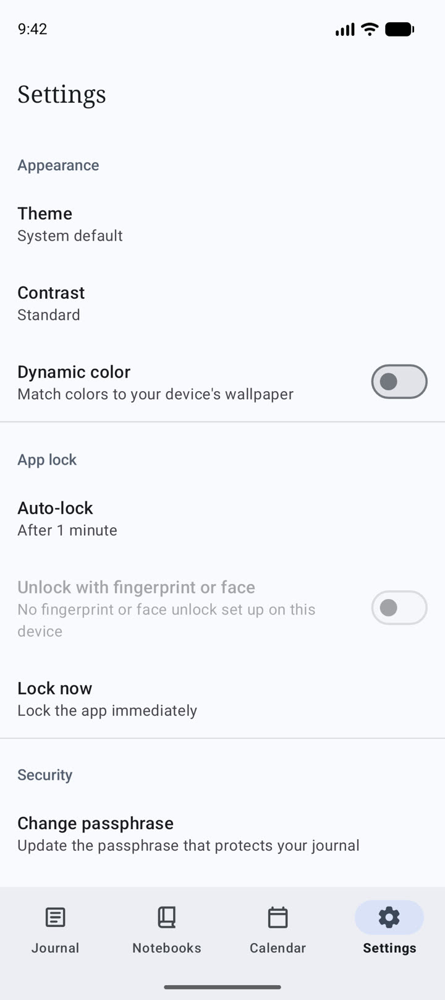
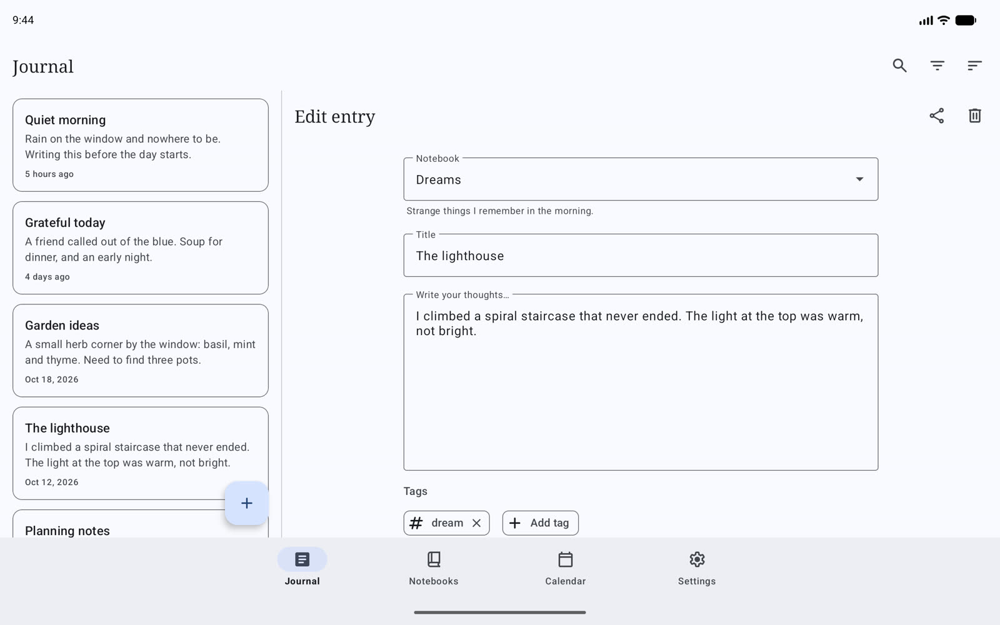
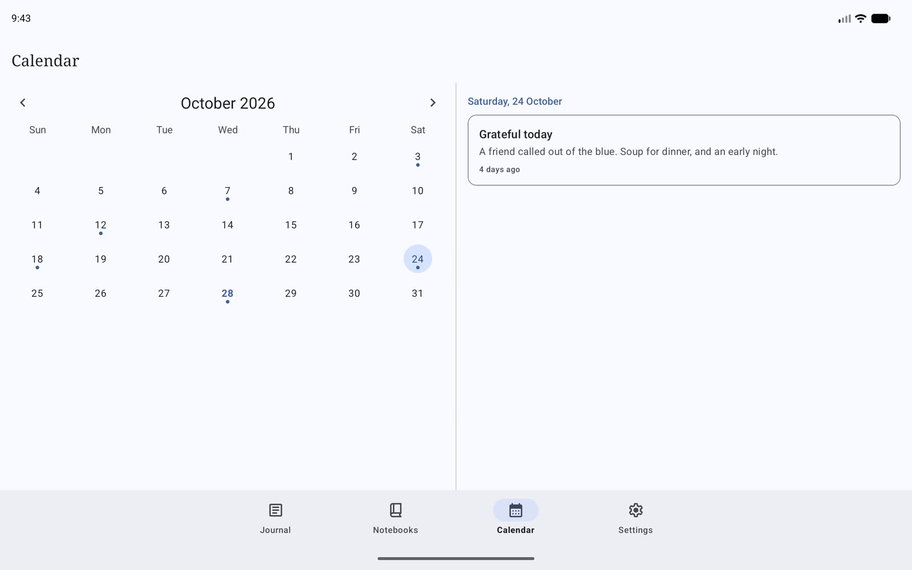

<div align="center">


# Dearest

**Your diary. Your device. Nobody else's.**

Dearest is a simple, open-source diary app built to be fully private and fully offline. Every entry is encrypted on your device with a passphrase only you know. There is no account and no server, and nobody, including the developer, can read your journal.

</div>

## Features

* **Encrypted, with no recovery:** Your whole journal is encrypted with AES-256 (via SQLCipher) and keyed by your passphrase. There is no reset and no backdoor, which is what makes the privacy real.
* **Fully offline:** Dearest requests no internet permission, so it cannot send your data anywhere. You can check this in your system's app settings.
* **App lock:** Auto-lock, a privacy screen that covers the app the moment you switch away, screenshots and screen recording blocked, and an escalating delay after wrong passphrases. Fingerprint or face unlock is optional and always falls back to your passphrase.
* **Notebooks and tags:** Keep separate diaries, and add tags that cut across them.
* **Search, filter and calendar:** Full-text search with notebook and tag filters, sorting, and a calendar showing the days you wrote.
* **Autosave and undo:** Drafts save as you type, and a deleted entry can be undone right away.
* **Backup and export:** An encrypted backup protected by a password you choose, or an export to plain text, CSV or JSON.
* **Phones and tablets:** A two-pane layout on large screens, light and dark themes, adjustable contrast and Material You colors.

## Screenshots

<div align="center">
  
  
  
  
  
  
</div>

On tablets the journal and calendar use two panes:

<div align="center">
  
  
</div>

## Verification

APK releases on GitHub are signed with my key. Verify one with
[apksigner](https://developer.android.com/studio/command-line/apksigner.html#options-verify):

```
apksigner verify --print-certs --verbose dearest.apk
```

The output should look like:

```
Verifies
Verified using v1 scheme (JAR signing): false
Verified using v2 scheme (APK Signature Scheme v2): true
Verified using v3 scheme (APK Signature Scheme v3): false
Verified using v3.1 scheme (APK Signature Scheme v3.1): false
Verified using v3.2 scheme (APK Signature Scheme v3.2): false
Verified using v4 scheme (APK Signature Scheme v4): false
```

The certificate fingerprints should match these:

```
Owner: CN=Mowtiie
Issuer: CN=Mowtiie
Serial number: 8a256fdcdde50069
Valid from: Wed Jun 10 22:57:23 PST 2026 until: Sun Oct 26 22:57:23 PST 2053
Certificate fingerprints:
         SHA1: 56:4E:2C:DB:E4:06:C9:EC:15:E6:BC:D9:0A:88:38:72:8B:FB:13:20
         SHA256: 8B:67:51:F3:C3:31:85:63:5F:98:95:30:B6:C0:73:A1:39:7B:3D:41:2B:EF:AE:69:06:A2:EB:58:45:D2:DE:63
```

**Warning:** Only install Dearest APKs signed with the key above.

### PGP Signing

Each release is also signed with my PGP key. This confirms that I published that exact file, independently of GitHub's account security.

**Public key fingerprint:**
```
9EA2 8F46 7802 5092 7643 1B69 42B5 FA42 AA63 90E1
```

Import the key, then check that the fingerprint GPG prints matches the one above. That match is what establishes trust.

```
curl -O https://mowtiie.cc/PGP_PUBLIC_KEY.asc
gpg --import PGP_PUBLIC_KEY.asc
```

Every release includes a detached `.asc` signature next to the APK. Verify it with:

```
gpg --verify dearest-vX.X.apk.asc dearest-vX.X.apk
```

A valid signature looks like:

```
Good signature from "Mowtiie <mowtiie.dev@gmail.com>"
```

PGP is an extra check, not a replacement for `apksigner`. Verify both for the highest confidence.

## Mapping Files

Each release includes a `mapping-<version>.txt` file next to the APK. Match it to the version in a crash report's header and use it with `retrace` from the Android SDK to read the stack trace.

## License

This project is licensed under the GNU General Public License v3.0. See the
[LICENSE](LICENSE) file for details.
